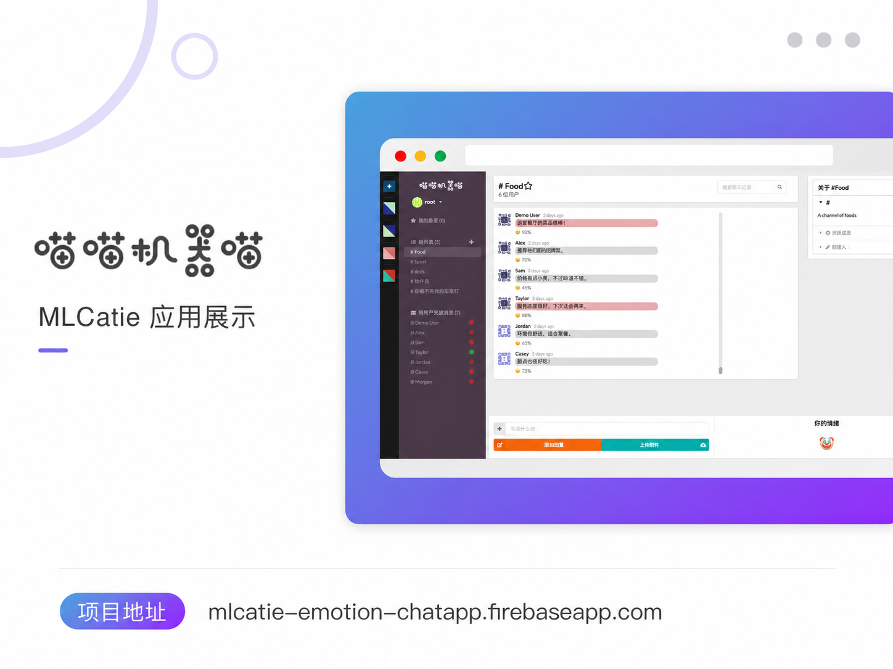
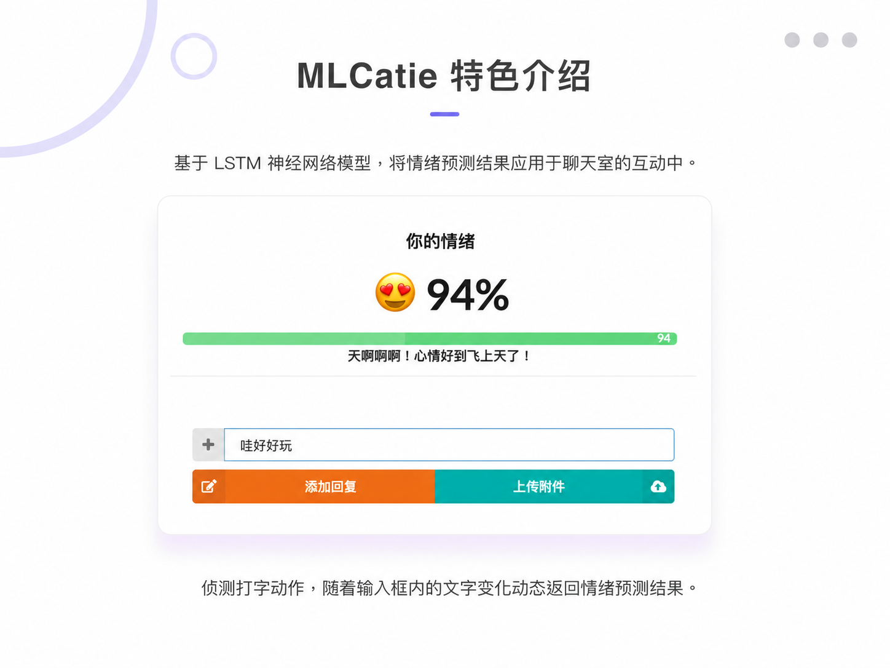
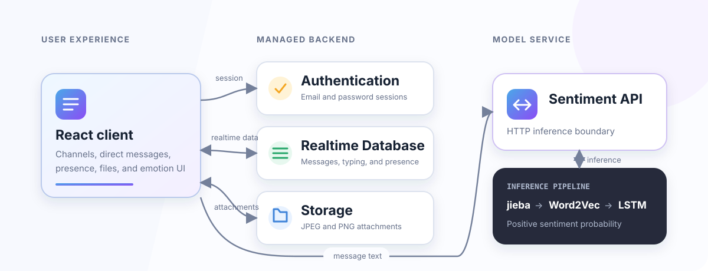

# MLCatie Emotion Chat

MLCatie is a real-time chat application that combines channel-based messaging with Chinese sentiment inference. Firebase provides authentication, realtime synchronization, presence, and image storage; a separate LSTM service analyzes message text and returns a sentiment score used for the in-chat emotion indicator.

The hosted chat application is still available at [mlcatie-emotion-chatapp.firebaseapp.com](https://mlcatie-emotion-chatapp.firebaseapp.com/). The original hosted sentiment endpoint has been retired, so chat data remains available while live sentiment inference is being restored through the companion API.

## Project origin and recognition

MLCatie was developed as a team project in the 2019 Machine Learning course at Peking University's School of Software and Microelectronics. Under the Ministry of Education–Microsoft Industry-University Cooperative Education Program, the team was rated **Outstanding Team (优秀团队)** on 17 June 2019.

This was a collective course-project honor rather than a placing in an external Microsoft competition. Will Cheng's contributions covered the sentiment model, Flask API, React/Firebase chat interface, and realtime presentation of emotion scores.

## Application preview



*Channel-based messaging with presence, direct conversations, and per-message sentiment indicators. Historical account and message data has been replaced with neutral demo content.*



*The message composer presents the model score before the text is sent and retains attachment support.*

## What it supports

- Email and password authentication
- Public channels and direct messages
- Realtime message delivery
- Online presence and typing indicators
- Channel favorites and unread counts
- Message search and active-member summaries
- JPEG and PNG attachments with upload progress
- Per-user color themes
- Chinese sentiment scores and emotion indicators on text messages

## System overview



The client and model service are kept in separate repositories:

- This repository contains the React and Firebase application.
- [`lstm-sentiment-flask-api`](https://github.com/RocketWill/lstm-sentiment-flask-api) contains the Chinese sentiment inference service and pretrained model assets.

## Data flow

### Chat messages

1. Firebase Authentication establishes the user session.
2. The client subscribes to the selected channel or direct conversation.
3. New messages are written to Firebase Realtime Database.
4. Active clients receive the new record through Firebase listeners.
5. Image attachments are stored in Firebase Storage and referenced by URL.

### Sentiment inference

1. The message composer sends Chinese text to the sentiment API.
2. The service tokenizes the text with `jieba` and maps tokens through the saved Word2Vec vocabulary.
3. The LSTM returns a positive-sentiment probability.
4. The client maps the score to an emotion indicator and stores it with the message.

Sentiment analysis is an enhancement to the chat experience. A service outage should not prevent users from sending messages.

## Firebase data layout

```text
channels/{channelId}
messages/{channelId}/{messageId}
privateMessages/{userIdA}/{userIdB}/{messageId}
presence/{userId}
typing/{channelId}/{userId}
users/{userId}
  starred/{channelId}
  colors/{colorId}
```

Database and Storage rules are versioned in [`database.rules.json`](database.rules.json) and [`storage.rules`](storage.rules). Message writes validate the authenticated sender, direct-message writes are restricted to conversation participants, and uploads are limited to JPEG or PNG images under 5 MB.

## Local setup

This codebase uses the original Create React App generation and legacy dependencies. A dependency modernization is planned; on current Apple Silicon environments, the historical `fsevents@1.x` dependency may not compile. The hosted build remains operational, but local installation should currently be treated as a legacy-runtime task.

When using a compatible Node environment:

```bash
git clone https://github.com/RocketWill/MLCatie-emotion-chatapp.git
cd MLCatie-emotion-chatapp
cp .env.example .env.local
npm install
npm start
```

Populate `.env.local` with the Firebase Web configuration from the Firebase console:

```env
REACT_APP_FIREBASE_API_KEY=...
REACT_APP_FIREBASE_AUTH_DOMAIN=...
REACT_APP_FIREBASE_DATABASE_URL=...
REACT_APP_FIREBASE_PROJECT_ID=...
REACT_APP_FIREBASE_STORAGE_BUCKET=...
REACT_APP_FIREBASE_MESSAGING_SENDER_ID=...
REACT_APP_FIREBASE_APP_ID=...
REACT_APP_SENTIMENT_API_URL=http://localhost:5000
```

Firebase Web configuration identifies the project; authorization is enforced through Authentication and the committed security rules. Administrative credentials and service-account keys must never be placed in the client environment.

## Firebase deployment

After creating a production build:

```bash
npm run build
firebase deploy --only hosting,database,storage
```

Review rule changes against a development project before deploying them to the live Firebase project.

## Current status

| Area | Status |
| --- | --- |
| Firebase Hosting | Available |
| Authentication | Available |
| Realtime chat data | Available |
| Image storage | Configured |
| Original Heroku sentiment endpoint | Retired |
| Local modern-runtime support | Pending dependency modernization |

## Planned work

- Restore the sentiment API behind a versioned JSON endpoint
- Debounce and cancel superseded sentiment requests in the composer
- Keep message delivery available when sentiment inference is offline
- Migrate the client from the legacy CRA toolchain to a maintained React build setup
- Add Firebase emulator tests and end-to-end chat scenarios

## License

No standalone license has been added to this repository yet. The dependency licenses remain governed by their respective packages.
